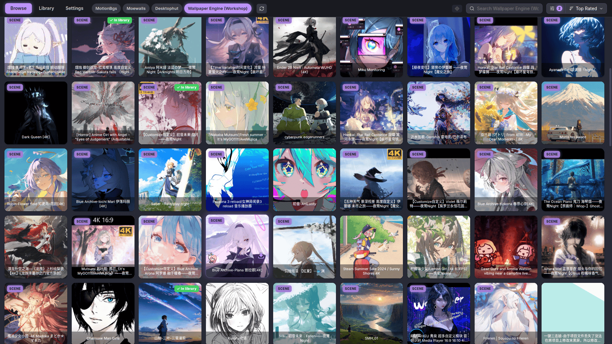
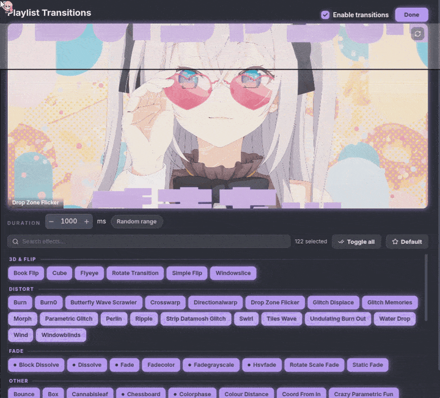
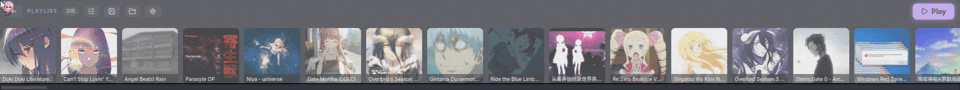
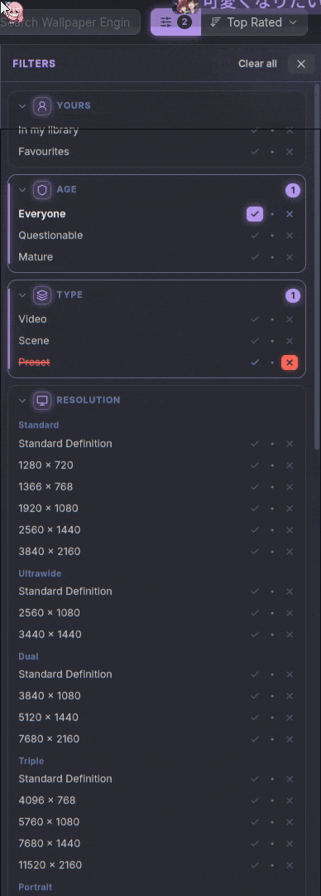
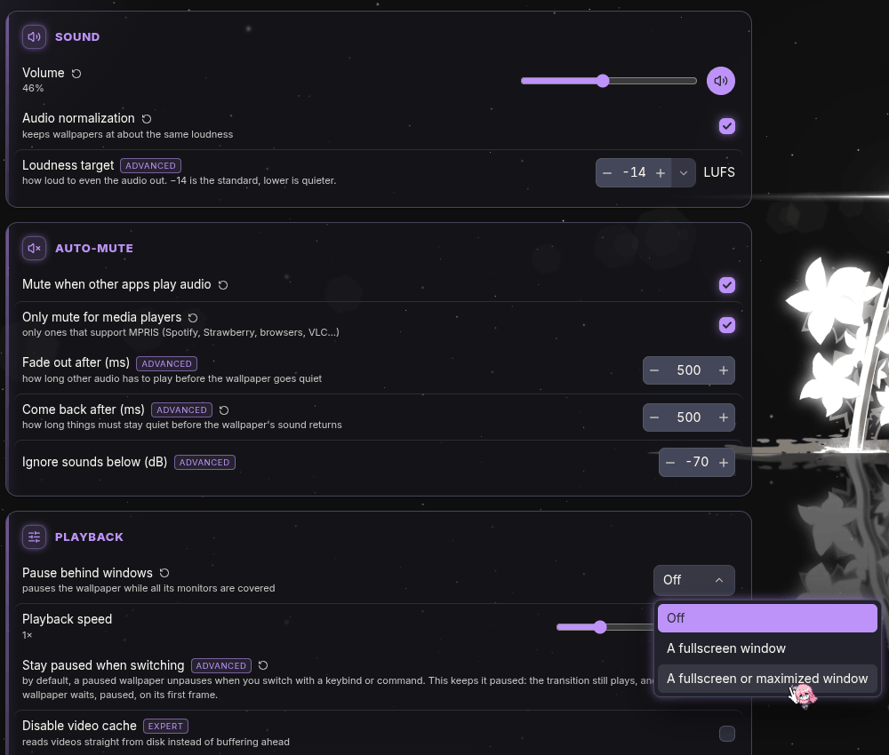
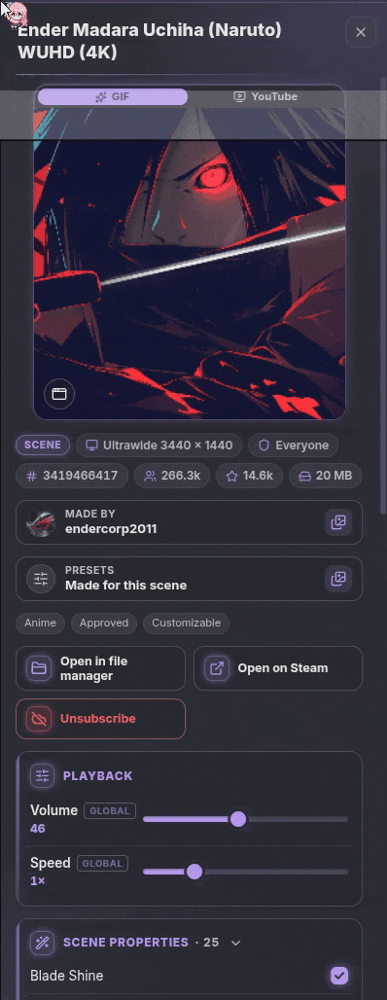

<p align="center"></p>

# Liascape

Liascape is a Linux app that puts wallpapers on your Wayland desktop.
The idea may sound simple, but the execution isn't.
Liascape goes further than any wallpaper app has gone. Ever.

**Liascape supports:**
- Videos
- GIFs
- Pictures
- Wallpaper Engine scenes
- Wallpaper Engine and Lively Wallpaper web wallpapers (coming soon)

## This is the last wallpaper app you'll ever need

The sheer overengineering has already added everything.

Browse and download from Wallpaper Engine's Workshop, MoeWalls, DesktopHut and more!



### Want cool transitions?

Sure, 122 of them.
Unlike Wallpaper Engine, ours don't freeze the current wallpaper on its last frame.
Unlike other Linux wallpaper apps, you don't need a PNG: use them on scenes, videos, GIFs or whatever your heart desires.



### Make playlists

<!-- stand-in until the animations are refined further -->


The playlist bar has a macOS dock-like animation, so you can look cool while changing your wallpaper.
Create, save and load playlists, and override the global settings with per-playlist ones!
Find the wallpaper that's playing with the click of a button.
Everything's thought of.

### Filter through wallpapers



### Make it behave how you want

Normalize audio, auto-mute wallpapers or pause them behind windows: the choice is yours.



### Tinker with your wallpapers without limits!

<!-- stand-in until the sidebar rework -->


## Quirks

Uh, some things do get a bit quirky sometimes, but do I blame them? No.

- **Scene compatibility isn't perfect.**
  A lot of effort has gone into making it better than the upstream [linux-wallpaperengine](https://github.com/Almamu/linux-wallpaperengine), but I can't guarantee perfection.
  If you notice a difference between how Wallpaper Engine renders a scene and how Liascape does, please open an issue. I'd love to fill in the gaps.
- **Windows fonts don't look perfect by default.**
  I can't legally ship Windows fonts in the repo, so you'll have to get them yourself in **very legal and ethical ways!**
  If Liascape can't find a Windows font on your computer, it uses a look-alike with a similar feel.
- **Steam shows you as playing Wallpaper Engine.**
  Workshop downloads through the Steam app need you to own Wallpaper Engine, because Liascape poses as Wallpaper Engine to make Steam download the wallpapers. While it does that, Steam also shows you as playing it.
  The status lasts from your first Workshop download until 60 seconds after you leave the Browse tab.

## Okay, but how do I use it!?

Simple:

1. [Install Liascape](#install).
2. Embrace the beautiful UI.
3. Go to the Browse tab and download your cute wallpapers.
4. Tinker with the wallpapers to your heart's content.
5. Set Liascape's settings however you see fit.
6. Add `liascape restore` to your compositor's startup (`exec-once = liascape restore` in Hyprland, `exec liascape restore` in Sway).
7. Done!

The rest you'll learn by using Liascape.

## Install

As with any other application, Liascape depends on 25 packages (and 364 more that npm and Cargo fetch for you while it builds).

**You'll need:**
- A Wayland compositor that supports wlr-layer-shell, such as Hyprland, Sway or KDE Plasma. GNOME doesn't, so Liascape can't draw a wallpaper there.
- An x86-64 machine.

**Optional, for the features that use them:**
- **Wallpaper Engine** (bought on Steam and installed): needed for its scenes and for Workshop downloads. Videos, GIFs, pictures, MoeWalls and DesktopHut work without it.
- **Steam**: for Workshop downloads.
- **PipeWire**: for auto-mute. Most current distros use it already.
- **playerctl**: for "Only mute for media players".
- **xdg-utils**: to open a wallpaper in your default app.
- **libsecret** (`secret-tool`): keeps your Steam sign-in in the system keyring instead of a file only you can read.
- **Windows fonts or their look-alikes**: for scenes that use them (see Quirks).

If something a feature needs is missing, Settings tells you at the top: what doesn't work and why.

<details>
<summary><b>NixOS and Nix</b></summary>

The flake brings everything with it, Electron and ffmpeg included. You need flakes enabled
(`nix.settings.experimental-features = [ "nix-command" "flakes" ];`).

```bash
nix run github:Kryxzort/liascape             # try it without installing
nix profile install github:Kryxzort/liascape # install it
```

Or add it to your system config:

```nix
# flake.nix
inputs.liascape.url = "github:Kryxzort/liascape";

# your configuration
environment.systemPackages = [ inputs.liascape.packages.${pkgs.system}.default ];
```

To build it by hand instead, `nix develop` in the cloned repo gives you a shell with every build dependency, and
`bash scripts/install.sh` builds from there.

</details>

<details>
<summary><b>Arch</b></summary>

```bash
sudo pacman -S --needed base-devel rust clang cmake git wayland wayland-protocols libglvnd mpv libpulse pipewire \
  libxkbcommon sdl2 freetype2 fontconfig harfbuzz glm lz4 zlib ffmpeg dotnet-sdk aspnet-targeting-pack nodejs npm
paru -S --needed electron45-bin   # or any AUR helper
```

Optional, for scenes that use Windows fonts (look-alikes, then the real ones):

```bash
paru -S --needed ttf-liberation ttf-carlito ttf-caladea ttf-cascadia-code ttf-selawik ttf-comic-neue ttf-tahoma ttf-ms-fonts
```

Then [build it](#then-build-it).

</details>

<details>
<summary><b>Debian / Ubuntu</b></summary>

```bash
sudo apt install build-essential cargo rustc libclang-dev libwayland-bin libwayland-dev libegl-dev libgles-dev \
  libmpv-dev libpulse-dev libpipewire-0.3-dev libxkbcommon-dev cmake git libsdl2-dev libfreetype-dev \
  libfontconfig-dev libharfbuzz-dev libglm-dev liblz4-dev zlib1g-dev libavformat-dev libavcodec-dev \
  libswresample-dev libswscale-dev libavutil-dev libgl-dev ffmpeg dotnet-sdk-10.0 nodejs npm
```

Liascape needs Rust 1.85 or newer. If your release's `rustc` is older, install Rust with [rustup](https://rustup.rs) instead.

There's no Electron package here: put an `electron45` or `electron` binary on your `PATH`, or point
`LIASCAPE_ELECTRON` at one. If there's no .NET 10 package, Microsoft's `dotnet-install.sh` installs the SDK for your
user.

Then [build it](#then-build-it).

</details>

<details>
<summary><b>Fedora</b></summary>

```bash
sudo dnf install gcc make cargo rust clang-devel wayland-devel mesa-libEGL-devel mesa-libGLES-devel mpv-libs-devel \
  pulseaudio-libs-devel pipewire-devel libxkbcommon-devel cmake git SDL2-devel freetype-devel fontconfig-devel \
  harfbuzz-devel glm-devel lz4-devel zlib-devel ffmpeg-free-devel ffmpeg-free libglvnd-devel dotnet-sdk-10.0 nodejs npm
```

There's no Electron package here: put an `electron45` or `electron` binary on your `PATH`, or point
`LIASCAPE_ELECTRON` at one. If there's no .NET 10 package, Microsoft's `dotnet-install.sh` installs the SDK for your
user.

Then [build it](#then-build-it).

</details>

### Then build it

```bash
git clone https://github.com/Kryxzort/liascape.git
cd liascape
bash scripts/install.sh
```

This installs the `liascape` command to `~/.local/bin` with a desktop entry, so make sure `~/.local/bin` is on your
`PATH`. If a package is missing, the script stops and prints the exact line to install it.

[contribution, issues and license section not written yet]

This README was written by an Emilia-obsessed meat bag, not a clanker. The same can't be guaranteed for the codebase (^﹏^)
