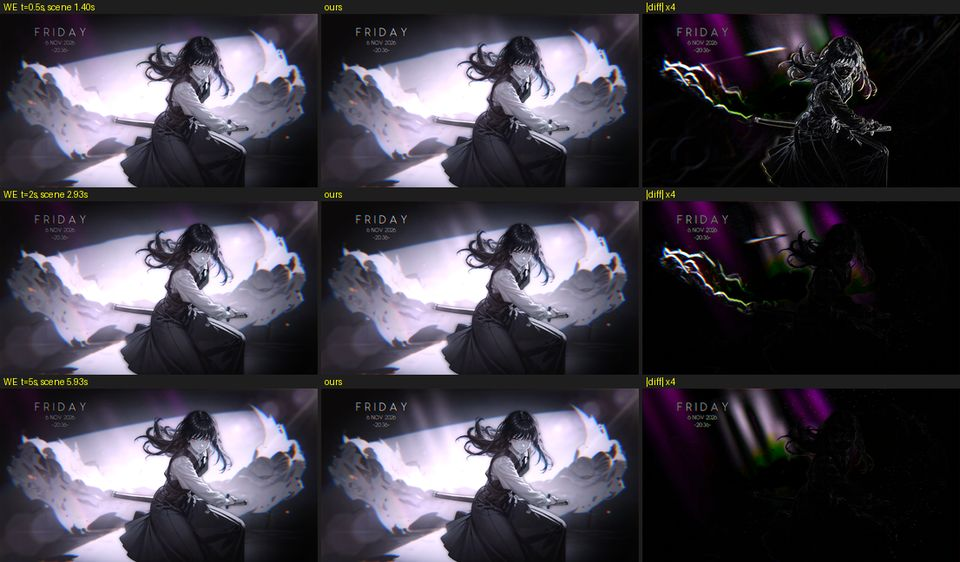

# Scene WE-reference compare — our render against real Wallpaper Engine

Generated by `src/player/tests/onmachine/scene_we_compare.sh` + `scene_we_report.py` from references captured by `scripts/dev/we-ref-capture.sh` — regenerate, don't hand-edit (notes come from `src/player/tests/onmachine/scene_we_notes.json`). **A ranked "look here first" list, not pass/fail.** Items are named by Workshop id only.

- **Run:** 2026-11-06T21:20:55+05:30, commit `35262a0+dirty`, LWE pin `313e1d21cdc3`, GPU NVIDIA GeForce RTX 3070 Ti, 595.84; references: Wallpaper Engine 2.8.485 under experimental-11.0-20261027b-x86_64, Ultra preset, MSAA x8, 30 fps, no audio device; 96 scenes.
- **How:** WE renders each scene in a window of the canvas's own aspect (<= 1920 x 1080) inside a headless gamescope; frames requested T s after its first frame with a picture. Each frame's real scene time is read from WE's own clock: the capture's private copy of the scene draws `g_Time` into a strip along the bottom edge (we-proton.md "The scene clock"); the row label says it. Ours: `liascape-scene-worker --lwe-smoke --shots` at that scene time (paced 30 fps, particle seed 7), same props / pointer path, at the capture's wall time (libfaketime) and with the fonts WE drew with (the Windows install's, through a private fontconfig file). The bottom 3 % (the strip) is left out of both. Each pair at 256 px wide: score = 0.30 ssim + 0.20 hist + 0.20 edges + 0.30 local (the preview compare's measures, no alignment needed); a scene's score is its mean over the times, `worst` its worst time.
- **Not render bugs by themselves:** WE's particles and random choices are unseeded (ours seed 7), a frame-rate-dependent effect runs at 30 fps on both sides, and media-driven layers have no media on either side.
- **Reference trust** (the `reference` column): `FXC` means WE compiled its shaders with Microsoft's compiler, as on Windows. WE loads the d3dcompiler_47 it ships (`bin\d3dcompiler_47.dll`, Microsoft 10.0.26100.7705) by path, and the Proton log shows it native, so Wine's own compiler was never used. Recompiling with the prefix's system32 swapped for the Windows install's gave byte-identical blobs (63 of 63). Most shaders come from the shader cache that came with the Windows install (compiled there); `(n compiled)` counts the shaders WE compiled here. `system fonts: Windows' …` means the scene names Windows system fonts (`systemfont_arial` …) and WE drew them with the real ones, linked into the prefix from the Windows install; ours gets the same faces in the compare (on a system without them, a stand-in's metrics change the wrapping: 3354740764's notepad). `fonts: the scene's own` means the fonts are packed in the scene. `FP16 swap chain: re-encoded` means an HDR scene at Ultra: WE presents it through an FP16 (scRGB) swap chain, which Windows sRGB-encodes for an SDR display but DXVK on gamescope shows raw (too dark, too saturated), so the capture re-encodes the frames as Windows shows them (exact but for 8-bit banding in the darkest tones; docs/player/spikes/we-proton.md). `clock: Wine's` means the scene reads the wall clock: ours is run at the capture's wall time. `video` means it has video textures; `video: crashed` means WE crashed on them under Proton. Differences in those classes are not our bugs until a Windows capture says so. Check by eye against Windows with `docs/player/reports/we-ref/compare/`.
- **Images:** side-by-sides (WE | ours | |diff| x4, a row per time) `we-ref/sbs/<id>.jpg`; WE frames (960 px JPEG) + manifests `docs/player/reports/we-ref/<id>/`.

## Focus

### 3184155462 (score 0.077)

The owner reports that the mouse-driven "liquid" (`cursorripple` on the Background layer 16: ripplescale 0.33, rippledecay 1, ripplespeed 0.5, ripplestrength 0.55, behind the `watereffect` property) looks much stronger in ours than on Windows. **At the same frame rate it isn't.** WE's own ripple depends on the frame rate:

- **The cause.** `cursorripple_apply_force.frag` scales each frame's force by `timeAmt = min(1/30, g_Frametime) / 0.02` times that frame's pointer delta. The simulate pass's decay has a per-frame floor (`max(1.001/255, …)`). So the force added per second goes with the frame time, and at a high frame rate the decay also wins.
- **The test.** A 1 s drag from (200,1600) to (1600,1600) native px between 1 and 2 s. `cameraparallax=false`, so only the ripple differs between `watereffect=true` and `false`. The measure is mean \|on − off\| (0–255) in the path's band (y 700–900 of the 1920 × 1080 frame).

| t (s) | 1.5 | 1.8 | 2.1 | 2.4 | 2.7 | 3.0 | 3.5 |
|---|---|---|---|---|---|---|---|
| WE, 30 fps | 2.1 | 4.8 | **5.6** | 4.2 | 2.4 | 1.2 | 0.4 |
| WE, 30 fps, two "on" runs (noise) | 1.3 | 2.0 | 2.0 | 1.5 | 1.0 | 0.7 | 0.4 |
| WE, 120 fps | 0.6 | 0.4 | 0.2 | 0.1 | 0.1 | 0.1 | 0.1 |
| ours, 30 fps (deterministic) | 1.7 | 2.9 | **3.7** | 3.0 | 1.6 | 0.6 | 0.0 |

- **The result.** At 30 fps ours has WE's strength, shape and masked area (the rock mass on the left; `docs/player/reports/we-ref/3184155462/ripple-diff.jpg`). At 120 fps, WE's ripple is about a tenth as strong. The owner's Windows WE is configured for **240 fps**, so what they see is the weak one.
- **What a fix should look at.** The frame rate and `g_Frametime` the player gives this scene, and how often it updates `g_PointerPosition` / `…Last` (a pointer delta accumulated over several frames but applied in one also overdrives it). The effect's constants and shaders are not the problem.
- **The references** are in `docs/player/reports/we-ref/3184155462/`: `drag/` (defaults, a drag along y = 1080 at 1–2 s), `ripple-on/`, `ripple-off/`, `ripple-on-120fps/` and `ripple-off-120fps/`. The full-size PNGs are in `~/.cache/liascape/we-ref/captures/{drag,rip-on1,rip-on2,rip-off1,rip120-on1,rip120-off1}/3184155462/`. The worker replays the same path with `--pointer 200,1600:1600,1600 --pointer-time 1-2 --prop cameraparallax=false --prop watereffect=true`.
- **Below,** the default capture (the pointer still) matches: it is the lowest-scoring scene, at the noise.

## Ranked

| # | id | score | worst (t) | ssim | hist | edges | local | |Δ| | reference | class | note |
|---|---|---|---|---|---|---|---|---|---|---|---|
| 1 | 3276522107 | 0.524 | 0.563 (0.5 s) | 0.39 | 0.46 | 0.22 | 0.91 | 0.042 | FXC | known | a 3D train interior: its post-processing layer letterboxes the frame over every layer, the clock strip too, so its frames carry the request time only (WE's clock 0.25–0.9 s along, see the 3D notes). The lit train layer flashes on a 2 s alpha loop; the rest is the windows' scrolling buildings (g_Time) and god rays. [sbs](we-ref/sbs/3276522107.jpg) |
| 2 | 3354740764 | 0.327 | 0.505 (0.5 s) | 0.24 | 0.25 | 0.09 | 0.63 | 0.062 | FXC, system fonts: Windows' arial/comicsans/consolas, clock: Wine's | fonts | fixed 2026-11-06 (fork d5f244a, 313e1d2): the dog's black box and the upside-down light shafts. Since the scene clock (2026-11-06) the 0.5 s frame is no longer black (0.959 → 0.14: WE's clock was ~1 s ahead, inside the opening fade). The notepad wraps as WE's once ours has Consolas: its 4 pt text in a 195.5 px box fits 21 Consolas characters, 24 of Inconsolata (this system's stand-in, 0.50 em vs 0.55) — the compare now gives ours the Windows fonts. The overall colour is two layers, found by removing layers from a private copy in both WE and ours: the Bliss layer with all its effects matches to 2.2 / 255. (1) The `Clouds` compose layer (id 58: turned 180°, scaled 1.2 × 2.3, `perspective`, procedural_noise with a perspective UV quad) darkens the bottom 30 % of the grass in ours (−14 to −32 / 255) where WE's barely changes anything; without it the grass matches (58,112 vs 59,112). TODO "compose layer turned 180°". (2) The sky's top right: ours' light shafts (`shine`); without them the sky matches (73,95 vs 76,97). WE's shafts are random and showed none in these runs. The clock is the capture's minute. [sbs](we-ref/sbs/3354740764.jpg) |
| 3 | 3490034653 | 0.289 | 0.326 (5 s) | 0.19 | 0.19 | 0.05 | 0.61 | 0.065 | FXC, fonts: the scene's own, clock: Wine's | random | Since the scene clock (0.414 → 0.289) the layers register to WE's within ~1 px (phase correlation over the trees, the background and the girl; the camera shake is a function of g_Time and now in phase). What is left: a lighter haze over the girl and the trees in ours (its three `light_shafts_1` systems inside compose layers; random in WE), the petals (random) and the clock text on her hair (the capture's minute). [sbs](we-ref/sbs/3490034653.jpg) |
| 4 | 3414858021 | 0.282 | 0.454 (0.5 s) | 0.27 | 0.13 | 0.17 | 0.47 | 0.056 | FXC, fonts: the scene's own, clock: Wine's | ok | matches once WE sees the pointer. It says FRIDAY: WEDNESDAY needs a Wednesday run. The rain is random. [sbs](we-ref/sbs/3414858021.jpg) |
| 5 | 3219908811 | 0.276 | 0.644 (0.5 s) | 0.29 | 0.10 | 0.16 | 0.47 | 0.071 | FXC, fonts: the scene's own, clock: Wine's | pointer | the 2 s and 5 s frames match since the scene clock (was 0.374), but for the notice panel at 5 s: WE's is still dim (fading in) where ours is fully in — look here next. The 0.5 s frame (scene 1.26 s) is parallax easing in from WE's late pointer and darker in WE. The petals are random. [sbs](we-ref/sbs/3219908811.jpg) |
| 6 | 3233141951 | 0.274 | 0.531 (0.5 s) | 0.25 | 0.14 | 0.10 | 0.51 | 0.061 | FXC, fonts: the scene's own, clock: Wine's | pointer | the 2 s and 5 s frames match since the scene clock (was 0.327; the dragon and the girl were "20 px apart": phase). The 0.5 s frame (scene 1.1 s) still differs: parallax easing in from WE's late pointer (the capture's xdotool nudge lands after load; wallpiper's frames don't have it). A light shaft at the top left is random in WE. [sbs](we-ref/sbs/3233141951.jpg) |
| 7 | 2951169110 | 0.218 | 0.605 (0.5 s) | 0.21 | 0.03 | 0.22 | 0.35 | 0.052 | FXC, fonts: the scene's own, clock: Wine's |  |  [sbs](we-ref/sbs/2951169110.jpg) |
| 8 | 2561227934 | 0.215 | 0.245 (0.5 s) | 0.09 | 0.21 | 0.06 | 0.44 | 0.055 | FXC, system fonts: Windows' comicsans | ok | the light shafts stand as in WE since 313e1d2 (particle sprites were upside down); they are random in WE. [sbs](we-ref/sbs/2561227934.jpg) |
| 9 | 3363252053 | 0.206 | 0.340 (0.5 s) | 0.17 | 0.06 | 0.13 | 0.38 | 0.042 | FXC, system fonts: Windows' calibri, clock: Wine's | random | fireworks at other moments (random in WE); 0.220 → 0.199 with the scene clock. The 0.5 s frame has the late pointer's parallax ease. [sbs](we-ref/sbs/3363252053.jpg) |
| 10 | 3289734539 | 0.167 | 0.487 (0.5 s) | 0.22 | 0.02 | 0.04 | 0.30 | 0.046 | FXC, system fonts: Windows' arial |  |  [sbs](we-ref/sbs/3289734539.jpg) |
| 11 | 3478602089 | 0.153 | 0.216 (5 s) | 0.02 | 0.20 | 0.17 | 0.24 | 0.051 | FXC |  |  [sbs](we-ref/sbs/3478602089.jpg) |
| 12 | 2672425887 | 0.136 | 0.172 (5 s) | 0.06 | 0.12 | 0.03 | 0.29 | 0.040 | FXC | ok | was 0.427 ("the demon fades in 3 s later"): the capture's time base. With WE's own scene time per frame (the clock strip) it is 0.136; WE's clock read 1.70 / 3.23 / 6.20 s at the 0.5 / 2 / 5 s frames. What is left is the 5 s frame's falling debris (random in WE). [sbs](we-ref/sbs/2672425887.jpg) |
| 13 | 2375914945 | 0.129 | 0.334 (0.5 s) | 0.13 | 0.07 | 0.06 | 0.22 | 0.029 | FXC |  |  [sbs](we-ref/sbs/2375914945.jpg) |
| 14 | 3013489778 | 0.125 | 0.178 (5 s) | 0.02 | 0.19 | 0.12 | 0.19 | 0.026 | FXC, fonts: the scene's own, clock: Wine's |  |  [sbs](we-ref/sbs/3013489778.jpg) |
| 15 | 3163060610 | 0.119 | 0.192 (0.5 s) | 0.08 | 0.07 | 0.04 | 0.25 | 0.019 | FXC (29 compiled), system fonts: Windows' comicsans, clock: Wine's |  |  [sbs](we-ref/sbs/3163060610.jpg) |
| 16 | 3516174947 | 0.105 | 0.234 (0.5 s) | 0.07 | 0.08 | 0.02 | 0.21 | 0.016 | FXC, fonts: the scene's own, clock: Wine's | ok | the preview-compare question ("needs a WE capture"): at its default lens size 0.75 WE also shows more than the canvas — black on all four sides at the canvas's aspect, bars top and bottom (132 px of 1080, the 0.125 that zoom 0.75 predicts) on a 16:9 desktop (we-ref/3516174947/desktop/); at lens 1 the canvas fills (lens1/). Our letterbox is WE's. The rest is its random camera path and the prompt box's timing. [sbs](we-ref/sbs/3516174947.jpg) |
| 17 | 2511663284 | 0.103 | 0.117 (5 s) | 0.07 | 0.07 | 0.06 | 0.18 | 0.014 | FXC, fonts: the scene's own, clock: Wine's |  |  [sbs](we-ref/sbs/2511663284.jpg) |
| 18 | 2290002190 | 0.102 | 0.170 (5 s) | 0.08 | 0.05 | 0.03 | 0.20 | 0.035 | FXC |  |  [sbs](we-ref/sbs/2290002190.jpg) |
| 19 | 3463520581 | 0.101 | 0.109 (5 s) | 0.06 | 0.03 | 0.04 | 0.23 | 0.015 | FXC (13 compiled) |  |  [sbs](we-ref/sbs/3463520581.jpg) |
| 20 | 3019192537 | 0.101 | 0.159 (0.5 s) | 0.03 | 0.18 | 0.15 | 0.09 | 0.010 | FXC, FP16 swap chain: re-encoded | ok | Was the worst (0.60): WE looked far darker and more saturated. That was the reference, not us. At Ultra WE presents an HDR scene through an FP16 (scRGB) swap chain holding lin () of the picture; Windows sRGB-encodes it for an SDR display, DXVK under Proton showed it raw. The frames are re-encoded now (we-proton.md "The FP16 swap chain"), and ours matches. The rest is camera shake (random). [sbs](we-ref/sbs/3019192537.jpg) |
| 21 | 3042492564 | 0.101 | 0.108 (0.5 s) | 0.05 | 0.06 | 0.12 | 0.17 | 0.013 | FXC, system fonts: Windows' comicsans, clock: Wine's |  |  [sbs](we-ref/sbs/3042492564.jpg) |
| 22 | 2828233985 | 0.100 | 0.248 (0.5 s) | 0.12 | 0.02 | 0.01 | 0.19 | 0.019 | FXC, system fonts: Windows' consolas, clock: Wine's |  |  [sbs](we-ref/sbs/2828233985.jpg) |
| 23 | 3395587987 | 0.086 | 0.113 (2 s) | 0.06 | 0.04 | 0.13 | 0.11 | 0.011 | FXC, FP16 swap chain: re-encoded | ok | Was 0.48 (WE a deep, dark blue): the FP16 swap-chain skew of 3019192537, fixed in the capture. Matches; the particles are random. [sbs](we-ref/sbs/3395587987.jpg) |
| 24 | 3184155462 | 0.077 | 0.080 (5 s) | 0.02 | 0.15 | 0.03 | 0.12 | 0.011 | FXC, fonts: the scene's own, clock: Wine's | measured | owner report: the cursor ripple is much stronger than on Windows. At a matched 30 fps it isn't (see Focus). [sbs](we-ref/sbs/3184155462.jpg) |
| 25 | 3419466417 | 0.077 | 0.080 (5 s) | 0.05 | 0.03 | 0.08 | 0.14 | 0.009 | FXC | ok | was 0.336 (the sword-glint sweep "at another phase"): the capture's time base. Rendered at WE's own scene time: 0.077. [sbs](we-ref/sbs/3419466417.jpg) |
| 26 | 3479521040 | 0.076 | 0.104 (5 s) | 0.03 | 0.07 | 0.02 | 0.17 | 0.012 | FXC, system fonts: Windows' arial, clock: Wine's |  |  [sbs](we-ref/sbs/3479521040.jpg) |
| 27 | 2679885269 | 0.076 | 0.086 (0.5 s) | 0.03 | 0.07 | 0.04 | 0.15 | 0.009 | FXC |  |  [sbs](we-ref/sbs/2679885269.jpg) |
| 28 | 3422085307 | 0.073 | 0.075 (0.5 s) | 0.01 | 0.20 | 0.07 | 0.06 | 0.006 | FXC |  |  [sbs](we-ref/sbs/3422085307.jpg) |
| 29 | 3309103316 | 0.069 | 0.196 (0.5 s) | 0.07 | 0.02 | 0.02 | 0.13 | 0.016 | FXC |  |  [sbs](we-ref/sbs/3309103316.jpg) |
| 30 | 2905264428 | 0.067 | 0.131 (0.5 s) | 0.04 | 0.09 | 0.03 | 0.10 | 0.021 | FXC |  |  [sbs](we-ref/sbs/2905264428.jpg) |
| 31 | 3516106265 | 0.062 | 0.083 (5 s) | 0.03 | 0.06 | 0.06 | 0.09 | 0.003 | FXC, fonts: the scene's own, clock: Wine's |  |  [sbs](we-ref/sbs/3516106265.jpg) |
| 32 | 3477054430 | 0.059 | 0.064 (2 s) | 0.03 | 0.03 | 0.07 | 0.10 | 0.006 | FXC, fonts: the scene's own | ok | the moon now takes the scene's distance fog like WE (0108: 149 → 129.6, WE 129.5). Left: the kitty's head turns from input.cursorWorldPosition, which WE casts into the 3D world and ours gives in scene pixels (head turned left in WE, front in ours). [sbs](we-ref/sbs/3477054430.jpg) |
| 33 | 3319542538 | 0.058 | 0.063 (0.5 s) | 0.03 | 0.02 | 0.06 | 0.11 | 0.004 | FXC, fonts: the scene's own, clock: Wine's |  |  [sbs](we-ref/sbs/3319542538.jpg) |
| 34 | 3291745179 | 0.056 | 0.062 (5 s) | 0.04 | 0.04 | 0.03 | 0.11 | 0.008 | FXC, fonts: the scene's own, clock: Wine's |  |  [sbs](we-ref/sbs/3291745179.jpg) |
| 35 | 3489263099 | 0.055 | 0.066 (2 s) | 0.02 | 0.07 | 0.09 | 0.06 | 0.006 | FXC, fonts: the scene's own, clock: Wine's |  |  [sbs](we-ref/sbs/3489263099.jpg) |
| 36 | 3509243656 | 0.053 | 0.074 (5 s) | 0.01 | 0.13 | 0.06 | 0.04 | 0.002 | FXC, system fonts: Windows' arial, FP16 swap chain: re-encoded, clock: Wine's | ok | a 3D scene whose intro is an engine.runtime fade from black: the clock strip sits under it, so its 5 s frame reads WE's clock and the earlier ones get that offset (WE's clock was 0.3–0.75 s ahead of t = 0). At WE's scene time it is 0.053 (was 0.261): the intro's timing was the capture's time base. Some runs read no frame at all (then only the request time). [sbs](we-ref/sbs/3509243656.jpg) |
| 37 | 2288455459 | 0.053 | 0.057 (5 s) | 0.03 | 0.02 | 0.04 | 0.11 | 0.004 | FXC |  |  [sbs](we-ref/sbs/2288455459.jpg) |
| 38 | 3174556087 | 0.049 | 0.056 (0.5 s) | 0.03 | 0.04 | 0.04 | 0.08 | 0.013 | FXC, system fonts: Windows' arial/consolas, clock: Wine's |  |  [sbs](we-ref/sbs/3174556087.jpg) |
| 39 | 3480481965 | 0.045 | 0.050 (5 s) | 0.02 | 0.06 | 0.08 | 0.04 | 0.003 | FXC (5 compiled), fonts: the scene's own, clock: Wine's |  |  [sbs](we-ref/sbs/3480481965.jpg) |
| 40 | 3042865984 | 0.044 | 0.070 (0.5 s) | 0.02 | 0.10 | 0.03 | 0.04 | 0.007 | FXC |  |  [sbs](we-ref/sbs/3042865984.jpg) |
| 41 | 1726902114 | 0.042 | 0.057 (5 s) | 0.01 | 0.05 | 0.01 | 0.08 | 0.009 | FXC | ok | the light shafts hang from the top left as in WE since 313e1d2 (particle sprites were upside down). They are random in WE. [sbs](we-ref/sbs/1726902114.jpg) |
| 42 | 3445973124 | 0.036 | 0.043 (2 s) | 0.01 | 0.02 | 0.04 | 0.07 | 0.003 | FXC, fonts: the scene's own, clock: Wine's |  |  [sbs](we-ref/sbs/3445973124.jpg) |
| 43 | 3461192631 | 0.035 | 0.038 (5 s) | 0.02 | 0.06 | 0.00 | 0.05 | 0.009 | FXC, fonts: the scene's own |  |  [sbs](we-ref/sbs/3461192631.jpg) |
| 44 | 2182433068 | 0.034 | 0.037 (2 s) | 0.02 | 0.02 | 0.06 | 0.04 | 0.004 | FXC, fonts: the scene's own, clock: Wine's |  |  [sbs](we-ref/sbs/2182433068.jpg) |
| 45 | 1195626192 | 0.030 | 0.035 (5 s) | 0.01 | 0.04 | 0.02 | 0.05 | 0.006 | FXC |  |  [sbs](we-ref/sbs/1195626192.jpg) |
| 46 | 2638125030 | 0.029 | 0.036 (0.5 s) | 0.01 | 0.04 | 0.05 | 0.02 | 0.005 | FXC |  |  [sbs](we-ref/sbs/2638125030.jpg) |
| 47 | 1884904087 | 0.027 | 0.027 (2 s) | 0.01 | 0.02 | 0.02 | 0.06 | 0.002 | FXC, system fonts: Windows' comicsans, clock: Wine's |  |  [sbs](we-ref/sbs/1884904087.jpg) |
| 48 | 2047150134 | 0.026 | 0.036 (5 s) | 0.01 | 0.02 | 0.02 | 0.05 | 0.002 | FXC, system fonts: Windows' consolas, clock: Wine's |  |  [sbs](we-ref/sbs/2047150134.jpg) |
| 49 | 3029971128 | 0.026 | 0.067 (0.5 s) | 0.02 | 0.02 | 0.02 | 0.05 | 0.006 | FXC |  |  [sbs](we-ref/sbs/3029971128.jpg) |
| 50 | 2683776412 | 0.026 | 0.038 (5 s) | 0.00 | 0.05 | 0.02 | 0.04 | 0.008 | FXC |  |  [sbs](we-ref/sbs/2683776412.jpg) |
| 51 | 3593587273 | 0.023 | 0.024 (0.5 s) | 0.01 | 0.06 | 0.01 | 0.02 | 0.006 | FXC | ok | was 0.499 ("a puppet at another pose"): the capture's time base. Rendered at WE's own scene time it is 0.023. [sbs](we-ref/sbs/3593587273.jpg) |
| 52 | 2921510865 | 0.023 | 0.043 (0.5 s) | 0.01 | 0.02 | 0.01 | 0.04 | 0.007 | FXC |  |  [sbs](we-ref/sbs/2921510865.jpg) |
| 53 | 2469881470 | 0.021 | 0.023 (0.5 s) | 0.01 | 0.02 | 0.02 | 0.03 | 0.005 | FXC, fonts: the scene's own, clock: Wine's |  |  [sbs](we-ref/sbs/2469881470.jpg) |
| 54 | 3023509773 | 0.019 | 0.025 (5 s) | 0.01 | 0.02 | 0.01 | 0.04 | 0.003 | FXC |  |  [sbs](we-ref/sbs/3023509773.jpg) |
| 55 | 3022080536 | 0.019 | 0.025 (0.5 s) | 0.01 | 0.03 | 0.02 | 0.03 | 0.002 | FXC |  |  [sbs](we-ref/sbs/3022080536.jpg) |
| 56 | 2064316482 | 0.018 | 0.019 (5 s) | 0.01 | 0.02 | 0.00 | 0.03 | 0.003 | FXC |  |  [sbs](we-ref/sbs/2064316482.jpg) |
| 57 | 2694785040 | 0.016 | 0.017 (2 s) | 0.00 | 0.06 | 0.00 | 0.01 | 0.003 | FXC |  |  [sbs](we-ref/sbs/2694785040.jpg) |
| 58 | 1934084447 | 0.015 | 0.018 (2 s) | 0.00 | 0.03 | 0.02 | 0.01 | 0.003 | FXC |  |  [sbs](we-ref/sbs/1934084447.jpg) |
| 59 | 2783122117 | 0.014 | 0.034 (5 s) | 0.01 | 0.02 | 0.00 | 0.02 | 0.009 | FXC | ok | was 0.562 (a crowd of skeletons "at another phase"): the capture's time base. Rendered at WE's own scene time it is 0.014. [sbs](we-ref/sbs/2783122117.jpg) |
| 60 | 2542468435 | 0.011 | 0.012 (0.5 s) | 0.00 | 0.04 | 0.01 | 0.01 | 0.003 | FXC, FP16 swap chain: re-encoded | ok | Two causes. The FP16 swap-chain skew (reference) and ours: WE scales an image's colour by its brightness in an HDR scene (GH 0x1402321d0), and the layer's 1.15 never showed (genericimage2 VERSION 2 has no g_Brightness term). Both fixed. [sbs](we-ref/sbs/2542468435.jpg) |
| 61 | 2815800031 | 0.010 | 0.011 (5 s) | 0.00 | 0.03 | 0.01 | 0.00 | 0.003 | FXC (2 compiled) |  |  [sbs](we-ref/sbs/2815800031.jpg) |
| 62 | 1155728109 | 0.010 | 0.010 (5 s) | 0.00 | 0.01 | 0.01 | 0.01 | 0.003 | FXC |  |  [sbs](we-ref/sbs/1155728109.jpg) |
| 63 | 2679248947 | 0.010 | 0.010 (5 s) | 0.00 | 0.01 | 0.01 | 0.01 | 0.003 | FXC |  |  [sbs](we-ref/sbs/2679248947.jpg) |
| 64 | 1556245028 | 0.009 | 0.011 (0.5 s) | 0.00 | 0.03 | 0.01 | 0.00 | 0.002 | FXC |  |  [sbs](we-ref/sbs/1556245028.jpg) |
| 65 | 2189783622 | 0.009 | 0.010 (0.5 s) | 0.00 | 0.02 | 0.02 | 0.00 | 0.001 | FXC |  |  [sbs](we-ref/sbs/2189783622.jpg) |
| 66 | 2932157836 | 0.009 | 0.011 (5 s) | 0.00 | 0.01 | 0.02 | 0.01 | 0.001 | FXC, fonts: the scene's own, clock: Wine's |  |  [sbs](we-ref/sbs/2932157836.jpg) |
| 67 | 1174926427 | 0.009 | 0.015 (2 s) | 0.00 | 0.01 | 0.00 | 0.02 | 0.001 | FXC |  |  [sbs](we-ref/sbs/1174926427.jpg) |
| 68 | 3134525336 | 0.009 | 0.009 (0.5 s) | 0.00 | 0.01 | 0.02 | 0.01 | 0.001 | FXC |  |  [sbs](we-ref/sbs/3134525336.jpg) |
| 69 | 3422383300 | 0.008 | 0.010 (2 s) | 0.00 | 0.01 | 0.02 | 0.00 | 0.001 | FXC |  |  [sbs](we-ref/sbs/3422383300.jpg) |
| 70 | 3749550751 | 0.008 | 0.009 (0.5 s) | 0.00 | 0.01 | 0.02 | 0.01 | 0.002 | FXC |  |  [sbs](we-ref/sbs/3749550751.jpg) |
| 71 | 3104056709 | 0.008 | 0.009 (2 s) | 0.00 | 0.03 | 0.00 | 0.01 | 0.005 | FXC |  |  [sbs](we-ref/sbs/3104056709.jpg) |
| 72 | 3291729669 | 0.008 | 0.008 (5 s) | 0.01 | 0.01 | 0.00 | 0.02 | 0.001 | FXC, fonts: the scene's own, clock: Wine's |  |  [sbs](we-ref/sbs/3291729669.jpg) |
| 73 | 2388299037 | 0.007 | 0.008 (2 s) | 0.00 | 0.01 | 0.02 | 0.00 | 0.001 | FXC, fonts: the scene's own, clock: Wine's |  |  [sbs](we-ref/sbs/2388299037.jpg) |
| 74 | 2219762084 | 0.007 | 0.008 (5 s) | 0.00 | 0.01 | 0.00 | 0.01 | 0.001 | FXC |  |  [sbs](we-ref/sbs/2219762084.jpg) |
| 75 | 3387433141 | 0.006 | 0.007 (2 s) | 0.00 | 0.01 | 0.01 | 0.01 | 0.001 | FXC |  |  [sbs](we-ref/sbs/3387433141.jpg) |
| 76 | 1797172968 | 0.006 | 0.007 (5 s) | 0.00 | 0.02 | 0.00 | 0.00 | 0.002 | FXC |  |  [sbs](we-ref/sbs/1797172968.jpg) |
| 77 | 3366535880 | 0.006 | 0.006 (5 s) | 0.00 | 0.02 | 0.01 | 0.00 | 0.002 | FXC |  |  [sbs](we-ref/sbs/3366535880.jpg) |
| 78 | 2325974975 | 0.006 | 0.006 (2 s) | 0.00 | 0.02 | 0.01 | 0.00 | 0.001 | FXC, fonts: the scene's own, clock: Wine's |  |  [sbs](we-ref/sbs/2325974975.jpg) |
| 79 | 2371103399 | 0.005 | 0.005 (2 s) | 0.00 | 0.02 | 0.01 | 0.00 | 0.001 | FXC |  |  [sbs](we-ref/sbs/2371103399.jpg) |
| 80 | 2134765860 | 0.005 | 0.005 (0.5 s) | 0.00 | 0.01 | 0.01 | 0.00 | 0.001 | FXC, fonts: the scene's own, clock: Wine's | ok | a room whose daylight follows the wall clock. Was 0.46: WE captured by day, ours rendered in the evening. Recaptured in the evening and rendered at the capture's wall time (libfaketime; the worker takes a fake clock): 0.005. [sbs](we-ref/sbs/2134765860.jpg) |
| 81 | 1160682576 | 0.005 | 0.005 (2 s) | 0.00 | 0.01 | 0.01 | 0.00 | 0.001 | FXC |  |  [sbs](we-ref/sbs/1160682576.jpg) |
| 82 | 1864677589 | 0.003 | 0.003 (0.5 s) | 0.00 | 0.01 | 0.01 | 0.00 | 0.001 | FXC |  |  [sbs](we-ref/sbs/1864677589.jpg) |
| 83 | 1264170639 | 0.001 | 0.001 (5 s) | 0.00 | 0.01 | 0.00 | 0.00 | 0.000 | FXC |  |  [sbs](we-ref/sbs/1264170639.jpg) |

## No usable WE reference

WE under Proton crashed on these (a null read in `wallpaper64.exe` called back from Proton's `mfmediaengine.dll`: scenes with video textures; the same with UMU-Proton 10, proton-cachyos 11, `videohardwareacceleration` off and `videoframework` `mfEngine`) or drew only black. Their frames show WE's crash dialog; the scores below compare against that and mean nothing.

| id | why | score (meaningless) | note |
|---|---|---|---|
| 3243449890 | WE crashed | 0.939 |  |
| 3046119914 | WE crashed | 0.924 |  |
| 3426575339 | WE crashed | 0.906 |  |
| 3089687436 | WE crashed | 0.902 |  |
| 2883756643 | WE crashed | 0.898 |  |
| 2886313155 | WE crashed | 0.897 |  |
| 3326873240 | WE crashed | 0.891 |  |
| 3556794116 | WE crashed | 0.852 |  |
| 2890767643 | WE crashed | 0.833 |  |
| 3432999904 | WE crashed | 0.812 |  |
| 3432876246 | WE crashed | 0.811 |  |
| 3028473503 | WE crashed | 0.810 |  |
| 3413117423 | WE crashed | 0.773 |  |

