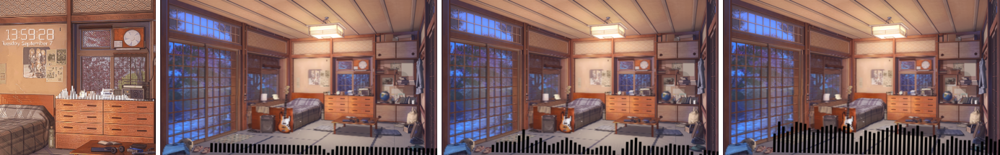
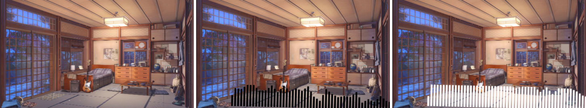

# Spike (a): LWE `next-v2` core renders a scene into our framebuffer

## Context

- Status: done 2026-10-20.
- Spec: `docs/superpowers/specs/2026-10-20-utopia-player-design.md` §6.1, §12.
- Code (throwaway): `spikes/lwe-core/`. It contains `build.sh`, `host.cpp` and `README.md`.
- Machine: NixOS, Hyprland, RTX 3070 Ti, NVIDIA 595.84 proprietary, gcc 15.2.

## Verdict: **GO**. Vendor `next-v2`

- **Pin:** `ddea3b493d2f4cca78a2e9547c4e61b92a14e0fc` (2026-08-03, "chore: formatting").
- **Build:** the `core` library builds standalone from `next-v2`, without CEF, GLFW or any windowing code.
- **Results:** 3/3 test scenes render into an FBO that we own, driven by our loop, our clock and our surfaceless
  EGL desktop-GL 3.3 core context on NVIDIA:
  - 0 GL errors
  - 0 KHR_debug errors or warnings
  - no crash
  - frames visibly match each item's preview. Bunk has element-level deviations, listed in §3.
- **What Phase 2 must add:** a short list of host-side workarounds plus 2–3 small patches. See §6, "What Phase 2
  must do". None of them blocks the design.

## 1. Build recipe (exact)

`spikes/lwe-core/build.sh` is the tested recipe. A clean build took **69 s wall** on 24 threads (550 s user time).
It compiles 153 translation units and peaks at 688 MB RSS.

### Steps

1. **Upstream checkout:**
   - `git clone https://github.com/Almamu/linux-wallpaperengine`, check out `ddea3b4`, then
     `git submodule update --init --recursive`.
   - The submodules: glslang-WallpaperEngine, SPIRV-Cross-WallpaperEngine, stb, json, MimeTypes, argparse, Catch2,
     quickjs, kissfft-WallpaperEngine, source-parsers.
   - glslang, SPIRV-Cross, kissfft, quickjs and nlohmann_json are built from these submodules. They are not system
     packages.
2. **Shell:** run everything inside `env -u LD_LIBRARY_PATH nix develop <repo>`. The repo devShell already provides:
   - gcc 15.2, make, pkg-config
   - ffmpeg-dev 8.1.2
   - mpv 0.41 (libmpv)
   - libglvnd-dev, libpulse-dev
3. **Ad hoc packages:** resolved from the repo flake's *locked* nixpkgs, so glibc matches the devShell's gcc:

   ```bash
   nix build --inputs-from <repo> --no-link --print-out-paths nixpkgs#<pkg> ...
   ```

   The script then puts the resulting paths on `PATH`, `CPATH`, `CMAKE_PREFIX_PATH` and `PKG_CONFIG_PATH`.
   - We use this instead of plain `nix shell` because `nix shell` only puts `bin/` on PATH. It does not expose
     headers, CMake configs or `.pc` files.
   - The packages:

     | package | why |
     | --- | --- |
     | `cmake` (4.1.2) | build system |
     | `SDL2` + `SDL2.dev` | resolves to sdl2-compat 2.32.70 (on SDL3). Scene audio output. |
     | `freetype` + `.dev` | text objects |
     | `glm` | headers. **Upstream CMake bug:** `common-object` never adds a glm include dir, so it only builds when glm is on the default include path (we use `CPATH`). |
     | `lz4` + `.dev` | `.tex` decompression |
     | `zlib` + `.dev` | pkg-config `zlib` |
     | `libGL` + `.dev` | CMake `FindOpenGL` (in `src/glad`) needs libglvnd on `CMAKE_PREFIX_PATH`. The devShell only has it via pkg-config. |
     | `gmpxx.dev` | **Undeclared upstream dependency.** `core/WallpaperEngine/Render/FBOProvider.cpp` has a stray `#include <gmpxx.h>` and uses nothing from it. A one-line patch deletes it. |

4. **Configure:**

   ```bash
   cmake -S lwe -B build/lwe -DCMAKE_BUILD_TYPE=Release -DWPBUILD_CORE=ON -DWPBUILD_WEBHELPER=OFF \
         -DWPBUILD_FRONTEND=OFF -DWPBUILD_DEVVIEWER=OFF -DWPBUILD_TESTS=OFF
   ```

   - `WPBUILD_WEBHELPER=OFF` is enough to skip CEF entirely. Nothing is downloaded.
5. **Build:**

   ```bash
   cmake --build build/lwe --target linux-wallpaperengine-core
   ```

   - Build the **target**, not `all`. The dev-viewer and webhelper `OBJECT` libraries are declared before their
     option gate, so `all` would still compile them, and they need GLFW and CEF headers.

### Output

- `build/lwe/lib/liblinux-wallpaperengine-core.so.0.0.1`: 13.3 MB, or 7.8 MB stripped.
- It exports **only `wp_*`** (66 symbols) through `version.lds` and `--exclude-libs,ALL`. The bundled glad,
  glslang and quickjs stay private.
- Runtime `NEEDED`: SDL2, freetype, lz4, ffmpeg (avformat, avcodec, swresample, swscale, avutil), libmpv, libstdc++.
  The library has a RUNPATH.
- The library does **not** link libGL or libEGL. It loads GL only through our `get_proc_address` callback.

### Host

```bash
g++ -std=c++20 host.cpp <glad .a> -llinux-wallpaperengine-core $(pkg-config --libs egl)
```

The host includes `include/linux-wallpaperengine/*.h`, `src/glad/include` and stb.

### Vendoring blocker (verified)

- `CMakeLists.txt` derives the version from `git describe --tags` and calls `FATAL_ERROR` when it does not match
  `vX.Y.Z`.
- A copy without its own `.git` sits inside our repo, and our repo has no tags. There, `git describe` returns
  `0b60682` and configure fails with "Cannot determine version". We ran this test.
- `third_party/lwe/` therefore needs a small CMake patch: accept `-DPROJECT_VERSION_OVERRIDE`, or fall back to the
  pinned version.

## 2. API calls used (in order), and what they actually do

| call | observed behaviour |
| --- | --- |
| `wp_config_create()` | Auto-detects Steam. **Fails on this machine**: it requires `appmanifest_431960.acf` in the *primary* Steam dir, but WE is installed in a secondary library (`/mnt/Games/Steam/SteamLibrary`). Without assets the first render logs `Cannot find ... /shaders/genericimage2.vert` and builds no renderer. **Fix:** `wp_config_set_assets_dir(cfg, ".../wallpaper_engine/assets")`. |
| `wp_config_enable_audio`, `wp_config_set_audio_volume`, `wp_config_set_mute_check`, `wp_config_set_property` | Config fields. The context keeps a *reference* to the config, so later setter calls apply live. See §5. |
| `wp_context_create(cfg)` | Creates the context **and opens an SDL audio device immediately**, even with `enable_audio(false)`. Measured: a sink-input exists with audio disabled. |
| `wp_context_set_gl_proc_address` | Our callback: `eglGetProcAddress`. The core calls `gladLoadGLLoader` through it on the first `wp_render_frame`, and again whenever a *different* context renders. |
| `wp_context_set_time_counter` | Our callback. It is the **only** time source for rendering (`g_Time`, particles, animations). |
| `wp_context_set_audio_input_mix` | Our callback. It supplies 1024 unsigned 8-bit samples per frame for the visualiser FFT. |
| `wp_project_load_folder(ctx, NULL, dir)` | Parses JSON and mounts the VFS. **No GL work.** Took 1.0 / 4.9 / 30.3 ms for the three scenes. Returns NULL on any exception. |
| `wp_project_hint_size(p, 1920, 1080)` | **Ignored for scenes.** It only resizes web projects. |
| `wp_project_get_width/height` | Return **1×1 until the first `wp_render_frame`**, because the renderer is built lazily. |
| `wp_project_set_output_framebuffer(p, fbo)` | The core renders the scene into its own FBO at the scene's native size, then draws a full-screen quad into our FBO with `glViewport(0,0,sceneW,sceneH)`. **Our FBO must be scene-sized.** |
| `wp_render_update_time(ctx)` | Calls our clock. Once per context per frame. |
| `wp_render_frame(p)` | Renders. The first call builds the renderer and costs 118 / 702 / 789 ms. |
| `wp_project_property_list_next`, `wp_project_property_set_value_by_name` | Listing works (1 / 6 / 8 properties). A live set returns true and changes later frames. See §4.5. |
| `wp_project_destroy`, `wp_context_destroy`, `wp_config_destroy` | Clean teardown in 2–28 ms. No crash. |

### Host pattern that works

1. Load the project.
2. Render frame 0 into a 1×1 scratch FBO.
3. Read `get_width/height` and allocate our RGBA8 FBO at that size.
4. Call `set_output_framebuffer`.
5. Loop `update_time` + `render_frame`.
6. Our own `glBlitFramebuffer` does a cover-fit plus a **vertical flip** into the 1920×1080 output.

### Output quirks we measured

- **Orientation:** the core's output is y-down: GL row 0 of our FBO holds the *top* of the picture. A conventional
  GL-to-image conversion, which flips rows, shows it upside down. Our first run did exactly that.
- **Alpha:** the core leaves **alpha = 0** in every output pixel (`opaque=0.0000` in all runs). The compositor must
  treat scene frames as opaque.

### EGL path

- `EGL_MESA_platform_surfaceless` **is** exposed by the NVIDIA 595 libEGL through glvnd, and it works: vendor
  NVIDIA, `3.3.0 NVIDIA 595.84`, core profile.
- The `EGL_EXT_platform_device` fallback is coded but was not needed.

## 3. Per-scene results (Step 3)

### Scene selection

All three come from `~/.local/share/Steam/steamapps/workshop/content/431960`. A script scanned all 96 scene items,
reading `scene.json` out of `scene.pkg`.

| pick | id | title | why |
| --- | --- | --- | --- |
| smallest folder | 1726902114 | 艾米莉亚 | 2.40 MB |
| most particle objects | 2371103399 | Kimi No Nawa [Dual Monitor] | 36 of its 43 objects are particles |
| audio visualiser | 2134765860 | Bunk | `supportsaudioprocessing`; properties `audiovisualization`/`barcount`/`barfrequency`; `Simple_Audio_Bars` effect |

### Measurements

- "Paced" runs used `--fps 60`, a real `CLOCK_MONOTONIC` clock, and saved frames 1/150/300.
- "Uncapped" runs used `--finish`, with `glFinish` every frame, so GPU time is included.
- Frame time is our host's time for `update_time` + `render_frame` + the cover-blit. It excludes readback and PNG
  writing.
- VRAM comes from `nvidia-smi -q -d PIDS` "Used GPU Memory" for our PID. **`--query-compute-apps` does not list the
  process at all**: a pure-GL process is type `G`, not compute.
- Peak RSS is `VmHWM`. Our process baseline before loading is about 114 MB (EGL + NVIDIA driver).

| scene | native size | renderer build | paced: fps, mean frame | uncapped: fps, mean / p95 frame | peak RSS (paced / uncapped) | VRAM | GL errors | animates (px diff f1→f300) | result |
| --- | --- | --- | --- | --- | --- | --- | --- | --- | --- |
| 1726902114 | 2048×1423 | 118 ms | 60.5, 0.16 ms | **2581**, 0.39 / 1.00 ms | 285 / 232 MB | **98 MiB** | 0 | 7 027 px | **PASS** |
| 2371103399 | 3840×1080 | 702 ms | 60.5, 0.68 ms | **905**, 1.10 / 1.56 ms | 372 / 286 MB | **241 MiB** | 0 | 53 686 px | **PASS** |
| 2134765860 | 1920×1080 | 789 ms | 60.5, 0.70 ms | **801**, 1.25 / 1.58 ms | 370 / 326 MB | **538 MiB** | 0 | 36 180 px | **PASS**, with fidelity deviations (see the Bunk notes) |

- The paced RSS includes our PNG and readback buffers.
- KHR_debug output (debug context) across the three paced runs: 0 high, 0 medium, 0 low. Notifications only
  (59 / 1956 / 362).

### Images

Each row: `preview.*` (first frame), then our frames 1, 150 and 300 after the cover-fit to 1920×1080.

**1726902114** (smallest). Same framing and content as the preview. The leaves particles barely change in the first
2.5 s: frame 1 vs 150 differ by only 22 px, frame 150 vs 300 by 7 049 px.


**2371103399** (particles). This is a 3840×1080 dual-monitor scene, so a 1920×1080 cover-fit shows the centre
(comet and clouds). The full native frame below shows the whole panorama, including the couple on the left as in
the preview. Comet trails, stars and clouds animate.


**2134765860** (visualiser), with our synthetic noise fed through `wp_audio_input_mix`. The bars move. The room,
lamp, guitar and dresser match the preview.



Deviations from the preview for this scene are scene-compatibility issues for the Phase 6 corpus, not embedding
issues:

- The bars are black and span the bottom edge. In the preview they are white, on the dresser.
- The clock and date text renders tiny, near the dresser.
- There is no master A/B for this scene: the legacy `linux-wallpaperengine` from nixpkgs (`0-unstable-2026-05-12`)
  **aborts on it at startup** with `nlohmann type_error.302`, while `next-v2` renders it.

### A/B with legacy master LWE

- For 1726902114, the legacy binary's `--screenshot` (DP-1, `--scaling fill`) has the same framing as our cover-fit.
- PSNR is 26.4 dB, because the frames come from different animation instants.

## 4. Step 4: what the API leaves open

### 4.1 Scene audio

- **Output path:** the context always creates an `SDLAudioDriver`:
  - `SDL_OpenAudioDevice(default, 48 kHz, F32, stereo, 4096-sample buffer)`
  - with SDL2 from sdl2-compat 2.32.70 on SDL3
- **Stream identity:** it shows up as its own PulseAudio/PipeWire sink-input:
  - `application.name` = our binary name
  - `node.latency 64/48000`
  - no `application.process.id` property
- **Disabling audio:** `wp_config_enable_audio(false)` only stops `CSound` from loading streams. The device and
  sink-input still exist, and they are silent.
- **Volume** (`wp_config_set_audio_volume`, 0..128):
  - Applies **live**: the SDL callback reads `config.volume` on every buffer.
  - Scaling is **linear in amplitude** (`SDL_MixAudioFormat`). Measured on 2371103399, 128 → 32 = **−12.03 dB**;
    linear expectation −12.04 dB.
  - That means 129 coarse steps. The quietest non-zero step is −42 dB, and the bottom steps are 6 dB apart
    (1 → 2).
  - There is no dB control and no ramp.
- **Mute / pause:**
  - The `wp_mute_check` callback is polled on every `wp_render_update_time`.
  - While it returns true, the SDL callback outputs silence **and stops decoding**. That makes it a **pause**, not a
    mute.
  - Measured: a 4.0 s mute window gave 4 150 ms of digital silence, and playback resumed **4 030 ms behind** the
    unmuted reference (envelope cross-correlation 0.97).
  - It is a hard cut with no anti-click ramp.
  - The callback lives in the *configuration*, so every context that shares a config pauses together.
- **Rendering pause:** `wp_rendering_pause_check` is stored but **nothing in core reads it**, and
  `CWallpaper::setPause` is a no-op for scenes. Pausing rendering means the host stops calling `wp_render_frame` or
  freezes its clock (see 4.2).
- **Visualiser input:**
  - Host-driven. Per `update_time`, the core pulls 1024 u8 samples (centre 128) via `get_frame`, runs a 1024-point
    real FFT, and reduces it to 16/32/64 bands.
  - The bands use only even bins below 128. In a 48 kHz feed that is ≤ ~6 kHz.
  - Smoothing is a fixed 0.3 per update, so it depends on the frame rate.
  - Measured on Bunk: a synthetic 6-tone input barely moved the bars (41 px changed). Broadband noise drives every
    bar (54 k px changed). We did not investigate why the tones barely registered.
  - Without input the bars sit at 0. This is good for liascape-player: the visualiser can be fed from our own audio bus.
- **Phase 2 consequence:** the core's audio cannot meet the global constraints as-is:
  - The constraints require dB gains, equal-power ramps and ≤ 30 ms anti-click ramps on running streams.
  - The worker should own scene audio. Add one patch, `wp_context_set_audio_output`: a host pull-callback driver
    implementing the existing abstract `Audio::Drivers::AudioDriver` (7 virtuals; today's SDL driver is 232 lines).
  - Estimated size: about 150–200 lines.
  - The fallback, controlling the SDL sink-input externally, is the legacy `liascape-audio`/pactl approach that §6.1
    retires.

### 4.2 Pausing and stepping time

- **Fake clock:** `wp_time_counter` fully controls rendering time.
  - Measured: we held the clock constant for 30 frames on 2371103399 (the particle scene). The frame-to-frame
    difference was **0.0000** for all 30 frames.
  - When the clock resumed, frames changed again (0.157 mean abs diff per channel per step of 1/60 s).
- **Stepping:** works. Two separate runs stepping 99 × 1/60 s matched within 255 of 2.07 M pixels (0.012 %).
  It is not bit-exact. Probable cause (not verified): particle randomness is not seeded deterministically.
- **Two exceptions** that the host clock does not cover:
  - Scene-script timers (`engine.setTimeout` / `setInterval` in `Scripting/EngineObject.cpp`) use
    `std::chrono::steady_clock`, so JS timers keep running during a host pause.
  - `g_Daytime` is never updated by core: it stays 0.
- **Audio:** the clock does not pause audio. Pause audio with the mute check (4.1) or the proposed audio-output
  patch.

### 4.3 Two projects in one process

**Yes, both ways.** We ran 1726902114 + 2371103399 for 300 frames at 60 fps in one process and one GL context:

| setup | mean frame | VRAM | peak RSS | teardown |
| --- | --- | --- | --- | --- |
| one shared `wp_context` | 1.36 ms | 332 MiB | 341 MB | 28 ms |
| one `wp_context` per project | 1.52 ms | 332 MiB | 343 MB | 8 ms |

- The VRAM of the pair is about the sum of the solo runs (98 + 241).
- Both frames render correctly side by side (image below).
- Caveats:
  - `active_context` is a process global. Rendering a project from another context re-runs `gladLoadGLLoader`.
  - `~Project` never removes itself from `context->projects`.
  - With two contexts we still saw **one** sink-input. Probable cause (inferred, not verified): SDL3 maps logical
    devices onto one physical stream. Per-project audio control inside one process is therefore not possible
    without the audio patch.
- **Design implication:** the spec's one-project-per-worker model sidesteps all of these caveats.


### 4.4 Truncated or broken content

- **Truncated `scene.pkg`:** we copied a scene and truncated `scene.pkg` to 50 %, then to 90 %, for 2371103399 and
  1726902114.
  - In all four cases `wp_project_load_folder` **returns NULL cleanly** in 1.3–39 ms. The parse exception is caught
    at the API boundary.
  - For 1726902114 it logs `Error parsing particle 'Leaves 2': ... empty input` to stderr.
  - No crash, no GL work.
- **A project that loads but fails to build its renderer** (for example, missing WE assets):
  - The first `wp_render_frame` logs `Failed to setup object ...` and returns.
  - `get_width` stays 1.
  - **The next `wp_render_frame` crashes with SIGSEGV.** `Project::render` sees a non-null `renderContext` and
    dereferences the null `wallpaper`. We reproduced this with `--keep-going`.
- **Error reporting:** none through the API. The API returns NULL or void and writes reasons to stdout/stderr through
  `sLog`.
- **Phase 2 rules:**
  - Treat "NULL from load" or "size ≤ 1 after the first render" as `broken` and never render again.
  - Capture the worker's stderr into the crash record.
  - Process isolation (§6.3) is justified by this crash.
  - A ten-line upstream-able patch, `if (!wallpaper) return;`, also fixes the crash.

### 4.5 Live properties (bonus)

- On Bunk at frame 60 we called:
  - `wp_project_property_set_value_by_name("visualizer_color", "1 0 0")`, which returned true
  - `wp_project_property_set_value_by_name("clock", "0")`
- At frame 90 the bars had changed from black (frame 59) to **white**: mean RGB in the bar playlist bar went from 71/64/72
  to 188/183/190, and 160 k pixels are pure white. Frames 61–89 were not captured, so the exact latency is unmeasured.
- So the live-property path works. The colour semantics for this scene are off: we asked for red. This is a
  scene-compatibility item.



Left to right: no audio input (bars at rest), our noise input (bars up), and after the live colour set.

## 5. Settings-apply-live check (project rule)

| setting | live? | how |
| --- | --- | --- |
| Volume | yes | `wp_config_set_audio_volume` on the live config. Coarse and linear: the worker should apply dB gain itself once it owns audio. |
| Mute / pause | yes | Mute check. Hard cut, pauses audio. |
| Scene properties | yes | `wp_project_property_set_*`. |
| fps, pause | yes | Owned by the host loop and clock. |
| Output size | n/a | The scene renders at native size. The worker or compositor scales, so a resize never needs a reload. |

`SceneMonitors` per-monitor fps and primary, launch-only today, become host-loop properties.

## 6. What Phase 2 must do (GO conditions)

### Host-side, no patch needed

1. Pass the assets dir explicitly.
2. Render frame 0 into a scratch FBO, then size the output to `get_width/height`.
3. Flip vertically.
4. Treat alpha as opaque.
5. Call `update_time` once per frame.
6. Treat NULL or 1×1 as broken, and never render again after a failed build.
7. Feed the visualiser from the player's audio bus.

### Patches in `patches/lwe/`

1. CMake version without git tags. Vendoring blocker, verified.
2. Drop the stray `gmpxx.h` include and add the glm include dir.
3. Host audio-output driver, `wp_context_set_audio_output`. Needed for dB gains and ramps. About 150–200 lines.
4. *(Optional, upstream-able)* Null-`wallpaper` guard in `Project::render`. Prevents the second-render crash.

### Size note for 4K scenes

Of the 93 library scenes whose size we could read, 43 are 3840×2160. The largest is 3104056709 at 7467×4200. A
native RGBA8 frame is therefore 33 MB typical and 125 MB at most. For dmabuf export
(spike b), the worker should downscale to the output size before export. The cover-blit cost is already included in
the frame times above.

### Not tested here

- Web projects through `CWeb`. Core still compiles the WebManager IPC client. By code reading, it fork/execs
  `WPENGINE_WEBHELPER_PATH` from `WebManager::init`, which only `CWeb`'s constructor calls, so scenes never spawn
  it.
- Video-type projects inside core (`CVideo`, libmpv).
- Mouse input.
- Long soak and leaks.

## 7. If this had been NO-GO (for reference)

- `next-v2` is 36 commits ahead of `main`, all by Almamu. `main` (2026-06-09) is an ancestor, so nothing in master
  is missing.
- The split touched **380 files, +18 268 / −7 978 lines**:
  - +16 807 / −6 736 in C/C++
  - +1 597 lines for the public C API and its `frontends/` glue alone
- Re-creating an embedding API on master would be a patch of that order, about 1.6 k lines of API plus the
  render-target and clock plumbing. The spike shows we do not need to write it.

## 8. Phase 2 follow-up (2026-10-27): assets-free scenes — the D7 probe

Plan Task 1 Step 6 asked to record here whether a scene renders without WE's `assets/` (it
said §7, which this file already used). **It does, for a clear colour alone:**
`patches/lwe/tests/fixtures/min-scene` (`project.json` type scene + a `scene.json` with a camera,
`general.clearcolor` `0.2 0.4 0.6`, a 64×32 orthogonal projection and no objects) builds with no
assets dir at all (`wp_config_set_assets_dir` refuses an empty dir; Steam auto-detection finds no
WE in the primary library here): native size 64×32, centre pixel `51 102 153 255` after three
frames (`host_api_test` `min_scene_renders_without_assets`, the patched core). Anything with an
image, particle, text or effect needs `assets/shaders/*` (and `general.bloom` pulls in
`genericimage2` too), so real Workshop scenes stay on-machine (D7); the min-scene is a hermetic
real-LWE fixture for Tasks 4–9 if one is wanted (the synthetic renderer stays the main one).

A deterministic **broken build** needs no missing assets either: `fail-scene` (one object whose
`parent` does not exist) loads, then `CScene`'s constructor throws "Cannot find parent" — the
§4.4 crash reproduced without the owner's library (fixed by `patches/lwe/0004`).

The patched core (`patches/lwe/0001–0006`, `UPSTREAM.md`) rendered real scenes through
`liascape-scene-worker --lwe-smoke` with the host audio driver: 2371103399 (3840×1080, 0 GL errors,
one sound stream pulled by the host, no SDL device) and 1726902114 (2048×1423) — frames upright
and matching the previews (`.claude/rules/player-core.md` § Scene worker → "LWE core").
